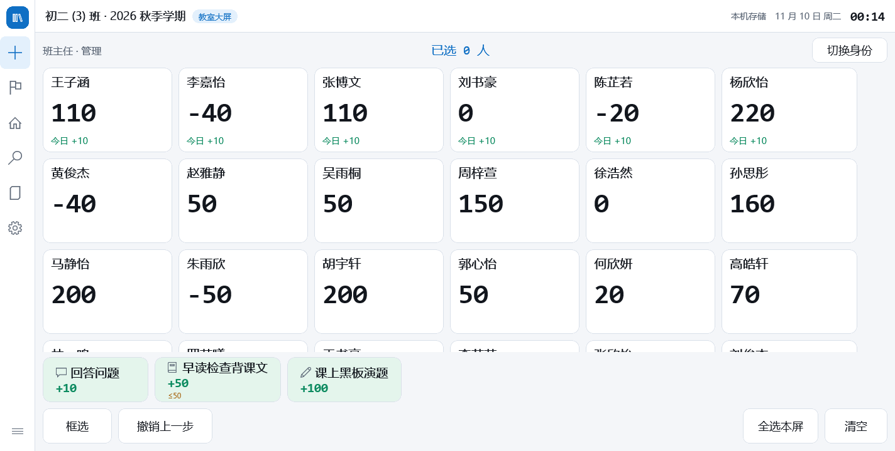
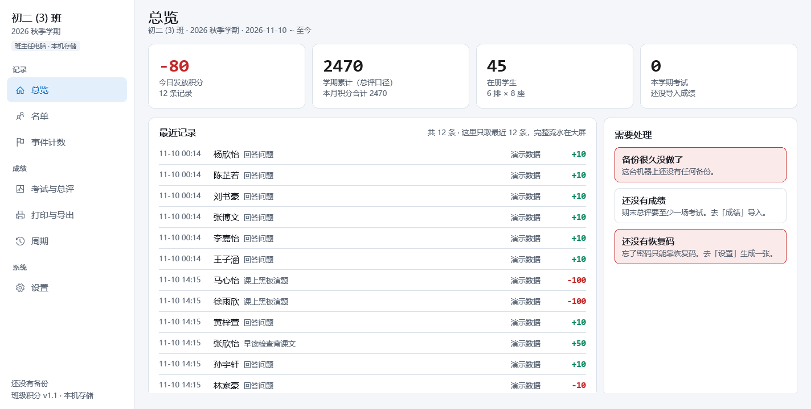
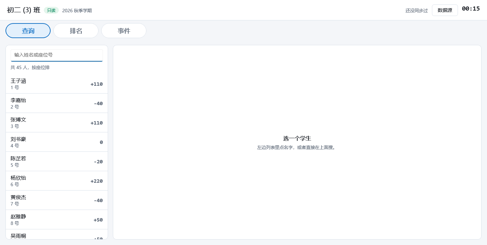
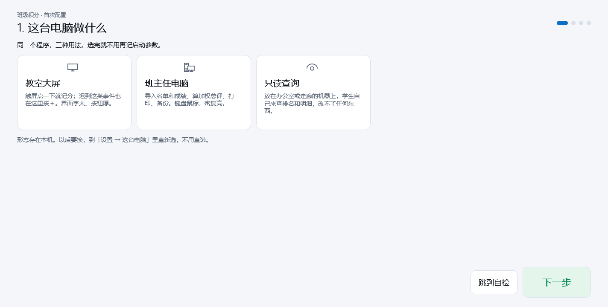

# 班级积分系统 · ClassPoints

面向中小学班主任的课堂积分工具。Windows 桌面应用（WinUI 3），**一个 exe 三种形态**，
第一次启动时在向导里选这台电脑做什么 —— 之后不用再管，也没有任何命令行参数要记。

| 形态 | 放在哪 | 页面 |
| --- | --- | --- |
| **大屏端** | 教室一体机 / 触屏电视 | 看板 · 记分台 · 事件计数 · 查分 · 明细 · 设置 |
| **电脑端** | 办公室电脑 | 总览 · 名单 · 事件计数 · 成绩 · 打印 · 周期 · 设置 |
| **只读端** | 走廊、任意一台机器 | 查分 · 排名 · 事件（**没有任何写入口**） |


## 它解决什么

- **站着加分快到不用想。** 卡片网格一屏 48 人（8 列 × 6 行自适应），长按 400 ms 后拖拽框选，
  一次给十几个人加分；短滑只滚动、手掌压屏不误触。撤销条挂在底部 5 秒。
- **刷卡认人，不是刷分。** PN532 串口读卡，刷卡 300 ms 内切到该学生。
  卡是"我是谁"，不是"我有权限"——管理操作一律要 PIN，每条记录带操作人可追溯。
- **账不会算错。** 流水表只追加，总分永远 `SUM(delta)` 现算，不存在"总分字段和流水对不上"。
  撤销 = 追加一条冲销行 + 给原行打 `reversed_at`，谁在什么时候撤的都有据可查。
- **事件计数。** 迟到、作业未交这类"只数次数、不加分"的事，单独两张表按周期统计，
  可以手动加减、可以改成准确次数。事件类型自己定，不要了是"停用"而不是删除。
- **断网照用。** 本地写永远先成功，同步只是后台一条链路；断网时界面上只多一个"待推送"角标。
- **一个云端放几十个班。** 每张业务表都带 `class_id`，学号 `01` 每个班各有一个，互不相干。

## 三端长什么样

大屏端：左轨只有图标，72 号大字，顶部常驻状态条（班级 / 时间 / 同步状态），教室三米外看得清。



电脑端：236 宽的文字侧栏、40 行高、Excel 导入、加权排名、一键出表。



只读端：顶部三个页签，第三种形状，一眼能和另外两端区分。



首次启动向导的第一步就问你"这台电脑做什么"：



---

## 一、编译与运行

### 环境

| 项目 | 版本 |
| --- | --- |
| .NET SDK | 10.0 |
| Windows App SDK | 2.6.5（`WindowsAppSDKSelfContained=true`，目标机不用另装运行时） |
| 目标框架 | `net10.0-windows10.0.26100.0`，最低 `10.0.17763.0` |
| 平台 | `x64` / `ARM64` |

不需要 Visual Studio，命令行就行：

```bash
dotnet build src/ClassPoints.App/ClassPoints.App.csproj -p:Platform=x64
```

打成可以整目录拷走的包：

```powershell
powershell -ExecutionPolicy Bypass -File scripts/publish.ps1 -Runtime win-x64
# 装了 PowerShell 7：pwsh scripts/publish.ps1 -Runtime win-x64
# 产物：dist/ClassPoints-win-x64/ ，整个目录拷到目标机，双击「启动.cmd」
```

只有一个启动脚本 `启动.cmd`，不带任何参数。用不上的语言资源在**编译期**就裁掉了
（`csproj` 的 `SatelliteResourceLanguages`），剩下九十来个 `Microsoft.ui.xaml.dll.mui`
目录是 WinUI 自带的，只占 4 MB 左右，别删。

> 改 `csproj` 时注意 `<EnableMsixTooling>` 必须是 `true`，哪怕不做 MSIX 打包（`WindowsPackageType=None`）。
> 设成 `false` 时 MSIX 公共 targets 整个不导入，`AddProjectPriToResolvedFileToPublish` 也就不存在，
> `dotnet publish` 出来的目录里没有 `ClassPoints.pri`，exe 一双击就 `XamlParseException`。
> 这个坑难查的原因是 `dotnet build` 的产物完全正常，只有 publish 的坏。`publish.ps1` 末段有硬性校验拦住它。

### 先看看长什么样

```bash
dotnet run --project tools/seed            # 生成 demo/demo.db：45 人、18 天流水、24 条事件
cp demo/demo.db "$LOCALAPPDATA/ClassPoints/classpoints.db"
ClassPoints.exe                            # 启动时选「班主任电脑」
```

演示库里的账号：班主任密码 `123456`，班委密码 `246810`，卡 UID `04A2B3C4D5E680`。

### 命令行参数与环境变量

唯一的参数是换库路径（演示、多班并行、验收用）：

| 参数 | 作用 |
| --- | --- |
| `--db=<路径>` | 用指定的库文件 |

排障用的环境变量（正常使用不需要设）：

| 变量 | 作用 |
| --- | --- |
| `CP_SNAP=<目录>` | 自截图模式：逐页渲染 PNG 后退出，见第八节 |
| `CP_MODE=board\|desk\|viewer` | 验收时强制形态，只影响这一次运行、不写库 |
| `CP_NORESIZE=1` | 不按上次尺寸还原窗口 |
| `CP_SYNC_PROXY=<url>` | 显式指定同步代理（默认不走系统代理，原因见第十一节） |
| `CP_SYNC_TRACE=1` | 把每次同步推送的路径与状态码打到 stderr |

---

## 二、部署同步中枢（可选）

**不部署也完全能用。** 纯本地模式下备份就是同步，换机器用「整包备份 → 导入」。
只有"教室大屏和办公室电脑要看到同一份数据"时才需要这一步。

同步中枢是 `worker/` 里的一个 Cloudflare Worker，数据存在 D1（SQLite）。免费额度足够一个班用好几年。

### 0. 前置

- 一个 Cloudflare 账号（免费版即可）
- Node.js 22+
- 一个托管在 Cloudflare 的域名（**可选，但国内强烈建议**，原因见第 6 步）

### 1. 装依赖

```bash
cd worker
npm ci
```

### 2. 建 D1 库

```bash
npx wrangler login          # 浏览器里点一下授权
npx wrangler d1 create classpoints
```

命令会打印一段 TOML，里面有一行 `database_id = "xxxxxxxx-xxxx-..."`。**复制它。**

### 3. 把 database_id 填进配置

打开 `worker/wrangler.toml`，替换这一行的占位符：

```toml
[[d1_databases]]
binding = "DB"
database_name = "classpoints"
database_id = "把上一步打印出来的 id 粘这里"
```

不填的话本地开发能跑，一上远端就报"找不到数据库"。

### 4. 建表

```bash
npx wrangler d1 migrations apply classpoints --remote
```

迁移文件在 `migrations/`。这条命令是幂等的，以后升级版本时重跑一次就够 ——
它只应用还没跑过的那些。**上过线之后只能新增 `0002_xxx.sql`，不要再改 `0001_init.sql`**
（SQLite 改表要走 12 步重建，不能在原文件上改）。

### 5. 设令牌签名密钥

```bash
npx wrangler secret put TOKEN_SECRET
# 提示时粘贴一段 32 字节以上的随机串
```

生成一段：

```bash
openssl rand -base64 32
# Windows 没有 openssl：
# powershell -Command "[Convert]::ToBase64String((1..32 | %{Get-Random -Max 256}))"
```

这个值只存在 Cloudflare 上，不要写进任何文件。**换掉它等于让所有已配对的设备立即失效**
（客户端会提示重新配对），所以存好。

### 6. 绑自有域名（强烈建议）

不绑的话你会拿到 `https://classpoints-api.<你的账号>.workers.dev`，
而这个域名在**部分国内网络下直接不通**（代理 `CONNECT` 返回 502），
教室里表现成"同步一直失败"，而你在开发机上因为挂着代理完全看不出来。

取消 `wrangler.toml` 里这段的注释，改成自己的子域：

```toml
[[routes]]
pattern = "classpoints.你的域名.com"
custom_domain = true
```

前提是这个域名的 DNS 已经托管在**同一个 Cloudflare 账号**下，否则 wrangler 找不到 zone，`deploy` 会失败。
`custom_domain = true` 会自动建 DNS 记录、自动签证书，不用手动去 DNS 面板加。

### 7. 发布

```bash
npx wrangler deploy
```

输出里会告诉你最终地址。改了 `wrangler.toml` 之后重跑这一条即可。

### 8. 验证

```bash
curl -i https://classpoints.你的域名.com/api/v1/ping
```

返回 **401** 就是活的（没带令牌，所以拒绝）。返回 502/超时说明域名或路由没生效；
返回 200 反而不正常。

### 9. 客户端配对

1. 电脑端「设置 → 同步 → 服务器地址」填上面那个地址，点「在这台电脑上建班」——
   如果这台机器上已经有班级数据，它会先问你要不要把现有数据推上去。
2. 记下 8 位班级码，在其它设备上点「配对到已有班级」，输班级码 + 班主任密码。

之后每台设备都是一个完整的本地副本，写的操作先落本地，后台再推。

### 关于免费额度

一个 45 人的班，一学期大约 3000 条流水，边写边同步：

| 资源 | 免费额度 | 实际用量 |
| --- | --- | --- |
| Workers 请求 | 10 万次/天 | 每天几百次（写操作合并成批，读按 30 秒节流） |
| D1 存储 | 5 GB | 一学期不到 20 MB |
| D1 读行 | 500 万行/天 | 增量拉取，每次只读变更 |

**数据在境外**（Cloudflare 边缘节点，通常是香港/新加坡）。学校或家长问起时这要能一句话说清：
存的是本班几十个学生的姓名与积分，随时可整包导出，也可以换到自建服务器。

### 升级服务端

```bash
cd worker
npm ci
npx wrangler d1 migrations apply classpoints --remote   # 有新迁移才需要
npx wrangler deploy
```

**顺序不能颠倒**：服务端先上，客户端后升。云端要向后兼容，旧客户端才能继续用；
反过来做，旧 Worker 遇到新字段会 400，两台设备当场都不能用。

### 部署出问题先看这里

| 现象 | 原因 |
| --- | --- |
| `deploy` 报找不到 zone | 域名不在这个 Cloudflare 账号下，或者 NS 还没生效 |
| `d1 migrations apply` 报找不到库 | `wrangler.toml` 里的 `database_id` 还是占位符 |
| 教室那台一直"同步失败"，开发机好的 | 用的 `*.workers.dev` 域名被墙，绑自有域名 |
| 请求 500 而且只有走代理时出现 | 客户端默认 `UseProxy=false`；确实需要代理时设 `CP_SYNC_PROXY` |
| 所有设备同时要求重新配对 | `TOKEN_SECRET` 换过，或者重新 `deploy` 时丢了 secret |

---

## 三、部署客户端

三种形态都是同一个 exe，形态记在本机 `settings.app_mode`。要改：电脑端
「设置 → 这台电脑 → 切换为」，或点「重新运行首次配置…」—— **三种形态可以当场互换，不用重启、不用重装**。

### 预配置包：在家里配好，学校只用填分数

Cloudflare 部署、班级码、座位排布这些一辈子只做一次的事，不该在教室那台机器上重做。

电脑端「设置 → 预配置 → 导出配置包」，得到 `.cpcfg` 文件（U 盘拷走即可）。包里带：
云端地址、班级码、班级名、学期起止、座位布局、分值方案、加分项定义。
**不带**名单、成绩、流水，也**不带**班主任密码 —— 密码只存在账号里，不进包。

到学校那台机器，第一次启动向导的第 2 步就是「预配置」：选文件、填口令、点「套用」，
后面的步骤会自动跳过包里已经有的项。导完只剩三件事：贴名单、定分值、试加一分。

包默认用口令加密（DPAPI 换机后解不开，所以用口令派生密钥），口令 4–32 位，至少含数字或字母。
不加密也能导出，但文件里会有班级码，别随手发群里。导入是**幂等**的：同一个包导两次结果一样；
版本比本机新时会提示先升级程序，而不是硬塞进去。

---

## 四、目录结构

```
src/
  ClassPoints.Core/      领域层，无 UI 无 IO：排名、加权、缺考策略、姓名归一、密码哈希、图标目录
    Config/              预配置包（.cpcfg）的序列化、口令加密、校验与导入
  ClassPoints.Data/      数据层：SQLite 建表与迁移、仓储、入账、备份、打印数据、同步客户端
    Sync/                Dpapi（DPAPI 加密）、SyncStore、SyncClient、SyncService
  ClassPoints.App/       WinUI 3 界面
    Board/               大屏端六页（含事件计数）
    Desk/                电脑端七页（含事件计数）
    Viewer/              只读查询端三页（无写入口）
    Controls/            图标选择器、数字键盘、空状态、Toast
    Onboarding/          首次启动向导（形态 → 预配置 → 班级 → 名单 → 分值 → 认人 → 自检）
    Theme/               色板与样式（大屏 20/40/72，电脑 15/26/34，两套独立不缩放；浅/深两套取色）
    Services/            组合根、会话、PNG 自截图、打印、同步心跳、PN532 读卡
worker/                  Cloudflare Worker + D1 同步中枢（TypeScript）
  migrations/            D1 迁移（上过线之后只能加 0002_xxx.sql）
  test/smoke.mjs         接口契约测试（58 项，含多班隔离）
tools/
  seed/                  演示数据生成器
  tests/                 Core 单测 + 端到端同步测试
  shot/                  窗口截图与局部放大（截图工具，非验收主通道）
docs/                    设计与验收文档、界面截图
scripts/publish.ps1      单文件发布（顺带打 zip）
scripts/upload-cnb-release.sh   可选：把发布包挂到 CNB 版本库
scripts/prune-cnb-releases.sh   可选：清理 CNB 旧版本
.cnb.yml                 CNB 云原生构建流水线
.github/workflows/       GitHub Actions 流水线
```

---

## 五、数据、备份与事件计数

- 数据只有一个文件：`%LOCALAPPDATA%\ClassPoints\classpoints.db`。
- 备份目录：`%LOCALAPPDATA%\ClassPoints\backups\`，每天首次启动自动备份一次，保留 30 天。
- 换机器：`设置 → 备份与恢复 → 整包导出`，到新机器「从整包导入」。
- `entries` 表只追加。总分永远 `SUM(delta)` 现算，撤销是追加冲销行 + 给原行打 `reversed_at`。

### 事件计数

单独两张表 —— `counters`（事件类型）和 `counter_ticks`（每按一次一条流水）。
**故意不混进 `entries`**：混进去以后，总分、总评、导出、看板的每一处都得记着排除它，迟早漏一处，
而漏一处的后果是所有学生的分数集体偏高 —— 这种错不会报错，只会在家长会上被发现。

- 次数 = `SUM(value)` 现算。`value` 允许是 `±N`，所以一条流水就能表示扣回两次。
- 「把次数改成 5」= 补一条差额流水，不改历史行。两台机器同步时改历史必打架，补差额永远收敛。
- 减到 0 就不再往下减；撤销（`UndoLast`）也是补一条反向记录，不删行。
- 事件类型可以自定义：名称 + 图标（12 个预设或不要图标），不要了是「停用」不是删除。
- 只按周期统计，不参与积分。三端都能看；大屏能加减（触屏），电脑端能加减和改准确值，只读端只能看。
- **事件计数目前只在本机，不参与云端同步**（worker 的实体白名单里没有这两张表）。
  大屏和电脑端是两台机器时，教室里记的事件不会出现在办公室那台 —— 两个事件页的副标题都把这件事写在明面上。

---

## 六、同步是怎么设计的

- 本地写永远先成功，同步只在后台跑。
- 每条写操作带 UUIDv7 幂等键，重传不会重复入账。
- 云端按 `rev` 做乐观并发（落后就 409），按 `changelog` 游标做增量拉取。
- 一个 D1 库放几十个班：所有唯一约束都是"班内唯一"，所有读写按令牌里的班级收口。
  越权的结果是**看不见**而不是报错：查不到、删不动、抢不到主键，
  接口返回 200/404 而不是 403 —— 403 等于告诉对方"这个 id 存在"。
- 密码只在服务端做 PBKDF2，明文不落库、不入日志；客户端只存 DPAPI 加密的 refresh token。

细节见 `worker/README.md`。

---

## 七、测试

```bash
# 1) Core + Data 单测 131 项（纯内存，无需任何服务）
dotnet run --project tools/tests

# 2) Worker 接口契约 58 项（需要本地 wrangler dev 在 8787）
cd worker && npx wrangler dev --port 8787 --local
node test/smoke.mjs

# 3) 端到端同步 26 项（C# 客户端真连 Worker，两台设备互推互拉）
dotnet run --project tools/tests -- --sync http://127.0.0.1:8787
```

合计 **215 项断言**。

Worker 那 58 项里有 17 项专打多班隔离：两个班同时存在，学号 `01` 各算各的，
B 拉到 A 的学生/流水/周期/考试都是 0 条，B 删 A 的行返回 200 但不改一行，
B 抢 A 的主键被 `ON CONFLICT` 里的 `class_id` 守卫挡掉，B 撤 A 的批次、改 A 的权重都是 404。

那 131 项里有 29 项是事件计数（加减、改准确值、撤销、周期隔离、归档、图标迁移幂等），
有 17 项是 Excel 往返（ClosedXML 写 → NPOI 读，`.xlsx` 和 `.xls` 各来一遍）：
中文不乱码、学号 `01` 不被吃成 `1`、日期不变成 `45000`、公式按结果取、负数保号、尾部空行去掉。
这组用例是补上的 —— Excel 导入是批量录名单/成绩的唯一入口。

想验真实部署的端点，把第 3 步的地址换成自己的 Worker 地址即可。

### CI

- **GitHub Actions**（`.github/workflows/build.yml`）：`windows-latest` 编客户端 + 跑单测 + `publish.ps1` 出包并上传产物；
  `ubuntu-latest` 起 worker 跑 58 项契约测试。
- **CNB 云原生构建**（`.cnb.yml`）：一条管线跑 worker 冒烟，一条用 `dotnet/sdk:10.0` 编 `tools/tests`
  —— 顺手证明领域层是跨平台干净的。

两条流水线都有同一个坑：`wrangler dev` 是常驻进程，脚本跑完必须显式 `kill`，
否则容器会一直等到阶段超时（CNB 那边报 `error, 600135ms`，看着像测试失败，其实是没退出）。

### 界面验收：程序自渲染截图

远程会话 / 虚拟显示器上 WinUI 合成器不出画面，桌面截图拿不到内容，所以截图由程序自己渲染：

```bash
CP_MODE=board  CP_SNAP="…/shots/board"  ClassPoints.exe
CP_MODE=desk   CP_SNAP="…/shots/desk"   ClassPoints.exe
CP_MODE=viewer CP_SNAP="…/shots/viewer" ClassPoints.exe
CP_SNAP="…/shots/wizard" ClassPoints.exe          # 不带 CP_MODE 就截向导本身
```

逐页产出 PNG（`board-1-wall … board-6b-settings-bottom`、`desk-1-home … desk-8-theme-switched`、
`viewer-1-lookup … viewer-3-counters`、`wizard-1 … wizard-7`），长页面自动滚到底再补一张，
电脑端最后还会当场切一次主题验证共享画刷。

`CP_MODE` 只覆盖这一次运行、不写库，所以同一台机器可以连跑三组。
**WebView2 的内容抓不到**（独立合成表面，`RenderTargetBitmap` 拍不到），打印页的预览区在截图里是空白，
这不代表预览坏了。

---

## 八、界面约定

**不用 emoji。** 图标一律用系统自带的 Segoe MDL2 Assets 字形（私用区码点 `U+E000–U+F8FF`），
单色、不和配色打架、基线稳定，也不受系统 emoji 字体回退链影响（换了精简版系统也不会变成方框）。
图标目录在 `src/ClassPoints.Core/IconCatalog.cs`：12 个预设字形 +「不要图标」。
规则和事件都能选，存的是字形字符本身。老数据里的 emoji（`⭐`、`📖`）由
`Database.NormalizeIcons` 每次启动映射一遍，幂等。

**三端形状不同，不是同一套界面缩放。**

| | 大屏端 | 电脑端 | 只读端 |
| --- | --- | --- | --- |
| 导航 | 左轨 56 宽，只有图标 | 左栏 236 宽，文字 + 分组小标题 | 顶部三个页签，没有侧栏 |
| 顶部 | 52 常驻状态条（班级 / 大屏徽章 / 同步 / 日期 / 时钟） | 标题 + 副标题 | 60 状态条（班级 / 只读徽章 / 周期 / 同步 / 数据源 / 时钟） |
| 字号 | 20 / 40 / 72 | 15 / 26 / 34 | 介于两者之间 |
| 行高 | 68 起，按钮 52 | 40，按钮 32 | 只读列表 |
| 写操作 | 触屏加减 | 鼠标 + 键盘 | **没有** |

**同一句话只写一遍。** 班级名、同步状态、日期时钟都归外壳顶部那条，页面里不再重复 ——
新加常驻状态条时最容易犯的错就是页面里那句没删，屏幕上同一段话出现三次。

默认浅色：教室投影普遍偏暗，浅底黑字投出来最清楚。三端都能在「设置 → 外观」里切深色或跟随系统，
共用同一个设置项。切主题不动页面：C# 共享画刷与 XAML 的 `ThemeResource` 一起换。

---

## 九、可选：把发布包托管到 CNB

GitHub 的 artifact 要登录才能下、14 天过期、国内还经常连不上。如果自己也用
[CNB](https://cnb.cool) 托管代码，可以把手艺固定成一条链接：

```bash
pwsh scripts/publish.ps1                       # 顺带产出 dist/ClassPoints-win-x64.zip
CNB_REPO=<用户名>/<仓库名> CNB_TOKEN=<令牌> \
  bash scripts/upload-cnb-release.sh dist/ClassPoints-win-x64.zip
```

CI 里也是同一个脚本，需要两个仓库配置：variable `CNB_REPO` + secret `CNB_TOKEN`
（`repo-release:rw` 权限）。没配就跳过，不让流水线变红。

固定 tag `latest-build` + 固定文件名 = 链接永远有效；大版本用 `CNB_TAG=v1.2`：

```bash
CNB_REPO=alice/classpoints CNB_TAG=v1.2 CNB_NAME="ClassPoints v1.2" \
CNB_BODY="这一版改了什么…" CNB_TOKEN=<令牌> \
  bash scripts/upload-cnb-release.sh dist/ClassPoints-win-x64.zip
```

版本库很容易被悄悄吃满（一个版本挂一个几十 MB 的 zip），`scripts/prune-cnb-releases.sh`
只保留最近 3 个 `v*` 大版本和固定的 `latest-build`，CI 每次构建后自动跑：

```bash
CNB_REPO=<用户名>/<仓库名> CNB_TOKEN=<令牌> DRY_RUN=1 bash scripts/prune-cnb-releases.sh  # 先看会删什么
```

两个 CNB OpenAPI 的坑（写在脚本注释里）：请求缺 `Accept` 头时它回 **406 而不是 401**
（很容易误判成权限不足）；`asset-upload-url` 返回的 `verify_url` 是完整地址，
不能再拼一次 `api.cnb.cool` 前缀。

---

## 十、已知限制

- **客户端只有 Windows。** WinUI 3 只能在 Windows 上编；`Core` / `Data` 是跨平台的，但没做别的界面。
- **事件计数不参与同步**（见第五节）。
- **读卡器只支持 PN532 串口**（含模拟刷卡调试通道），没做 ACR122U 等 PC/SC 读卡器。
- **同步不含文件存储**：只同步结构化数据，头像/照片没有。
- **报告单导出 xlsx，不直出 PDF**：要 PDF 走「打印 → Microsoft Print to PDF」。
- **事件次数还没进 Excel 导出**。
- **卡可以克隆**（CUID 卡 UID 可写）：所以卡只定位成"认人"，不是"授权"。

## 十一、排障

**窗口全白但程序在跑。** 远程桌面、虚拟显示器、部分核显驱动下，WinUI 3 的合成器不呈现画面，
连最小 `Grid + TextBlock` 都不显示，日志与视觉树却完全正常。这不是程序问题；换一台带真实显示器的机器即可。
排查请用 `CP_SNAP` 自截图，它绕过窗口合成直接渲染视觉树。

**同步请求 500。** .NET 默认继承系统代理，走代理时请求行会变成绝对 URI（`POST http://host/path`），
Cloudflare 边缘与 `wrangler dev` 都只认 origin-form，直接回 500。客户端已默认 `UseProxy=false`；
学校网络确实需要代理时，用 `CP_SYNC_PROXY` 显式指定。

**发布出来的包一双击就 `XamlParseException`，但 `dotnet build` 的产物正常。**
`dotnet publish` 的目录里缺 `ClassPoints.pri`，根因是 `csproj` 里的 `EnableMsixTooling` 被设成了 `false`。
诊断：`ls dist/ClassPoints-win-x64/*.pri`，正常应该有 5 个。

**Excel 导入进来分数全是空白，而且不报错。** NPOI 2.8 起数值格式化改由 SkiaSharp 负责，
而 SkiaSharp 作为**传递依赖**时在 net10.0 上只提供编译期 `ref` 程序集、运行期资产是空占位 `_._`，
`SkiaSharp.dll` 不会被拷到输出目录。`DataFormatter` 一抛 `FileNotFoundException`，就被
`ExcelReader.CellText` 的 `catch` 吞成空串。所以 `ClassPoints.Data.csproj` 里必须**显式**引一次
`SkiaSharp`。删掉那行 `PackageReference` 就会静默复发，`tools/tests` 里的 Excel 用例会立刻抓到。

**退出时崩溃 `0xC0000005`。** 进程内 WebView2 未关闭会在 COM 终结器里崩。打印页已在 `Unloaded` 里
关闭浏览器，退出前也会先离开打印页。改动打印页时请保住这两个动作。

**打印没有系统对话框。** WinUI 版 WebView2 没有 `ShowPrintUIAsync`（那是 WPF/Win32 的 API），
所以改成「选打印机 + 无页眉页脚直接打」，纸张与边距由 `CoreWebView2PrintSettings` 控制。

---

设计文档见 `docs/班级积分系统-方案v2.md`，逐项验收记录见 `docs/验收记录.md`，
同步中枢的部署与接口细节见 `worker/README.md`。
